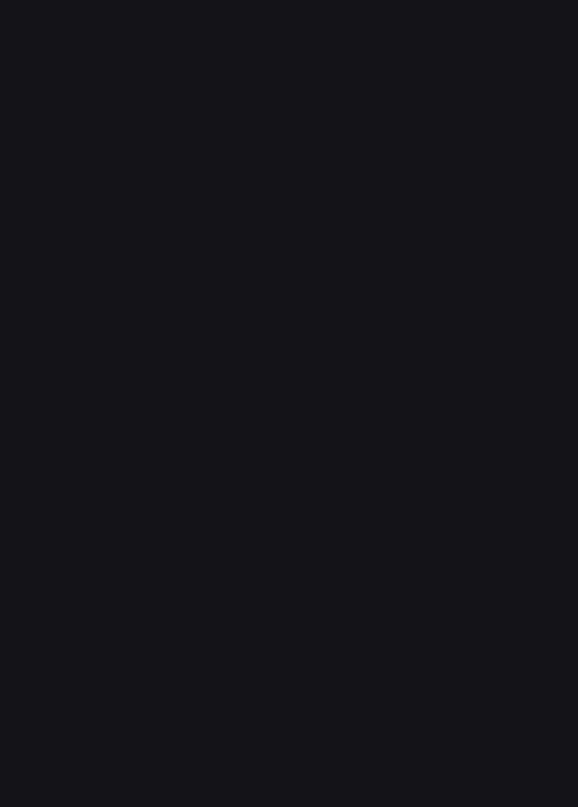

# traffic-light (도구 신호등)

[English](README.md) | **한국어**

컨텍스트에 뭐가 얼마나 들어 있는지 신호등 5색으로 보여 주는 Claude Code 사이드 패널입니다. 스킬, 플러그인, MCP 서버, 에이전트, 메모리 파일, 서브에이전트가 각각 얼마나 쓰는지도 보여 줍니다.



> 데모는 실제 패널 화면을 녹화한 것이며 커서와 자막만 덧입혔습니다. 서브에이전트가 도는 구간은 빨리감기입니다.

## 설치

```
/plugin install traffic-light --marketplace jueyi6/traffic-light
```

`/traffic`으로 패널을 엽니다.

## 신호등 5색

| 신호 | 뜻 |
| --- | --- |
| 🟢 사용함 | 이번 세션에서 썼음. 실행 중인 호출은 돌아가는 표시가 뜸 |
| 🟡 로드됨 | 정의 전체가 컨텍스트에 들어 있음 |
| 🔴 오류 | 실패함 |
| 🔵 목록만 | 이름과 설명만 컨텍스트에 있음 |
| ⚪ 지연 로드 | 꺼내 쓰기 전에는 컨텍스트에 없음 (숫자에 취소선) |

숫자는 모두 해당 신호의 색으로 표시됩니다. 같은 3색(🟢 🟡 🔴)과 개수가 상태줄에도 나옵니다.

## 패널 읽는 법

- **컨텍스트**: 전체 사용량과, 신호등 항목을 뺀 나머지(메시지, 시스템 프롬프트, MCP 안내문).
- **서브에이전트**: 자기만의 컨텍스트에서 돌기 때문에 토큰이 위 합계에 들어가지 않습니다. 줄마다 에이전트, 모델, effort와 `시작`(처음 들고 시작한 양: 시스템 프롬프트, 도구, 스킬. 첫 요청 기준으로 측정), `작업`(일하면서 쓴 양), `출력`, `도구`(도구 호출 수)가 나옵니다. 아래에 도구 이름이 나열됩니다. `상세 켬`을 누르면 비용이 더해집니다.
- **지금 / 방금**: 마지막 프롬프트 이후에 일어난 일입니다. 메시지 증가량(`💬 메시지 +1.1k`)과 쓴 도구를 마지막 턴 기준으로만 셉니다. 실행 중인 호출은 돌아갑니다. 누적 합계는 아래 신호등에 있습니다.
- **신호등**: 눌러 열면 그룹(스킬, 플러그인, MCP, 에이전트, 시스템, 메모리)과 항목이 나옵니다.
- **바뀐 숫자**: `A → B`는 패널이 세션을 처음 읽었을 때 A였고 지금은 B라는 뜻입니다(A는 흐리게, B는 색으로).
- **시스템 도구**: 이름을 나열하고 로드됨과 지연 로드로 나눕니다.
- **메모리 파일**: 파일(📂)을 누르면 해당 파일이 선택된 폴더가 열립니다.

버튼: `펼침`은 모든 섹션을 열고, `접음`은 닫습니다. `상세 켬/끔`은 서버별 도구, 플러그인별 스킬, 도구 호출당 대략적인 크기(`≈`, 글자 수 / 4), 서브에이전트 비용을 보여 줍니다.

무거운 세션은 줄 수 한도에서 잘라(`… 외 n줄 생략`) 패널이 항상 그려지게 합니다.

## 개인정보와 컨텍스트

- **모델 컨텍스트에 아무것도 더하지 않습니다.** 읽고 그리기만 합니다. 프롬프트나 도구 결과를 바꾸지 않고, 모델 호출도 추가하지 않습니다.
- 네트워크 호출이 없습니다.
- 도구 이름과 서브에이전트의 시작 크기를 알아내려고 로컬 세션 기록(과 각 서브에이전트 기록)을 읽습니다. 어디로도 보내지 않습니다.
- 메모리 파일을 누르면 내 컴퓨터에서 `explorer.exe`를 실행해 폴더를 보여 줍니다.

## 참고

- Claude 데스크톱 앱의 플러그인 패널용입니다. 탐색기 버튼은 Windows 전용입니다.
- 숫자는 엔진이 내놓는 컨텍스트 구성 값을 쓰므로 엔진의 합계와 맞습니다. 서브에이전트 `시작`/`작업`과 호출당 `≈` 크기는 위에서 설명한 대로 측정하거나 추정한 값입니다.

## 라이선스

[MIT-0](LICENSE)
